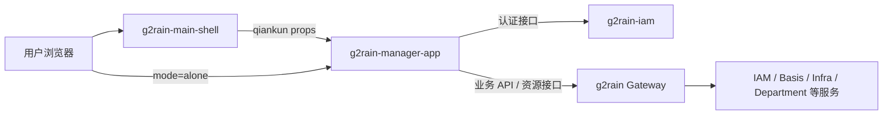
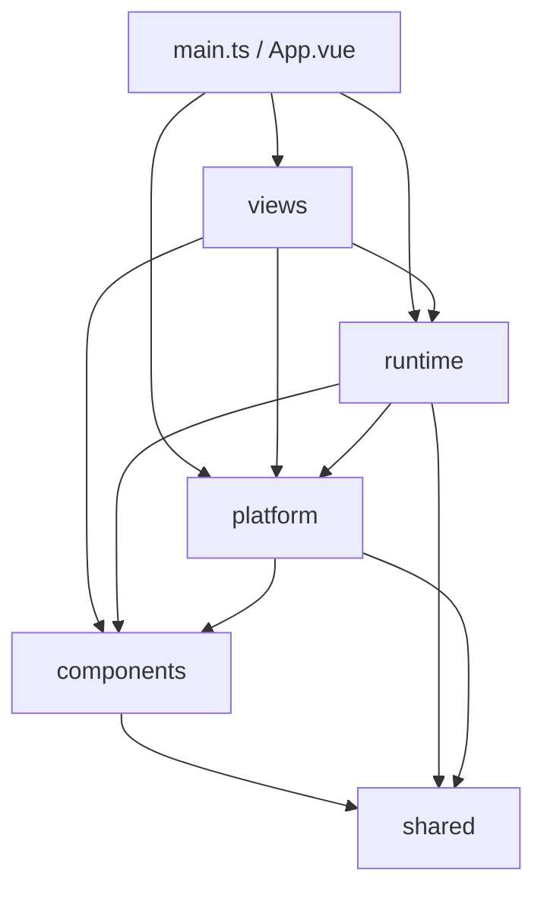

# 架构概览

本项目采用 g2rain [`frontend-app 1.0.0`](https://github.com/g2rain/g2rain/tree/architecture-v1.1.0/docs/architecture/profiles/frontend-app) 正式基线。中央 Profile 管理跨 App 的分层、运行、生成与安全规则；本页描述 g2rain-manager-app 的具体落地。

g2rain-manager-app 是平台管理控制台的 Vue 3 微前端子应用，承载账号与用户、机构与角色、资源权限、应用授权、身份提供方、服务注册和审计等管理用例。它负责前端交互、页面路由、权限呈现和平台运行时接入，不拥有后端领域数据。相对中央基线的当前偏差见[架构偏差](deviations.md)。

## 系统关系

- 集成模式由 main-shell 加载子应用并下发身份字段与 Locale；Token 经 Auth Bridge 定向消息传递。
- 独立模式由子应用自行发起 SSO，并在获得 Token 后加载应用资源。
- 业务服务通过 Gateway 暴露；IAM 的认证接口走独立代理路径。
- `/basis/authority/resources` 返回页面、页面元素和 API 端点，运行时据此组装路由与权限。

## 应用内部

图中表示目标依赖。HTTP/UI 反向依赖已消除；runtime 对 views 注册表的直接引用等仍见[架构偏差](deviations.md)。

## 核心事实

- `src/main.ts` 是组合根。模块加载时创建一次 `createStandardSubPlatform`，独立模式和 qiankun 都调用同一份 `definition.mount` / `unmount`；集成挂载前经 Auth Bridge `requestSharedAuth`。
- `src/platform/apps/adapter.qiankun.ts` 只注册 qiankun 生命周期，并把 props 交给组合根。
- `src/runtime/boot` 在 Token 可用后初始化 HTTP、资源、权限和路由。
- `src/views/route-map.ts` 是后端页面资源 `linkPath` 到前端组件的静态注册表。
- `scripts/database.sql` 与 `src/shared/config-util/config` 是构建输入/产物；引擎由 `create-g2rain-app` 提供，不参与浏览器业务运行时。

## 职责边界

本仓库负责平台管理界面、前端用例和本应用运行时，不负责：

- 外部 `create-g2rain-app` CLI 的参数交互与文件复制实现。
- main-shell 的菜单、Tab 和子应用注册管理。
- IAM 的 Token 签发与 Gateway 的后端鉴权。
- Basis、Infra、Department 等服务的数据所有权和后端业务校验。
- 在本项目文档中静默修改或覆盖中央 Frontend App 公共规则。
